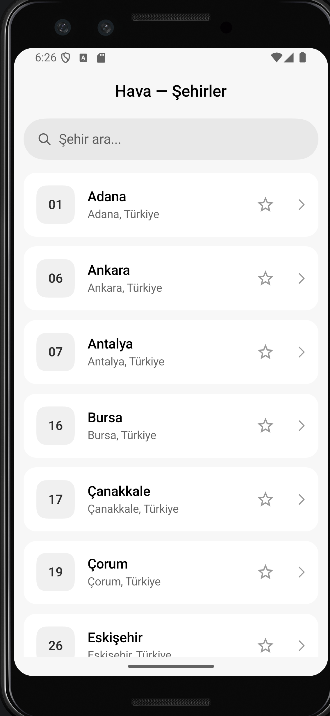
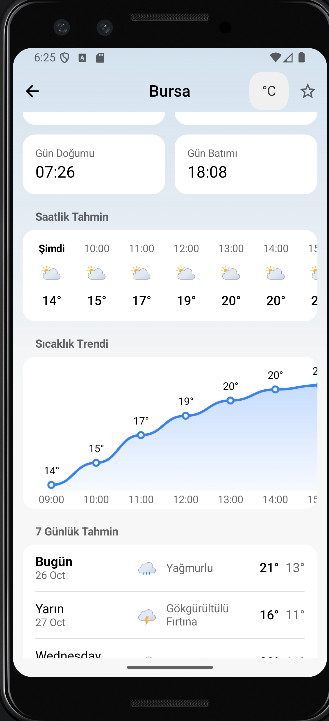
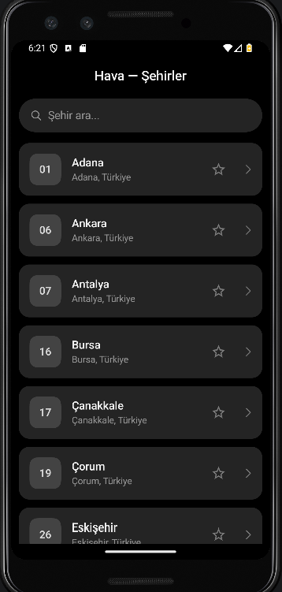
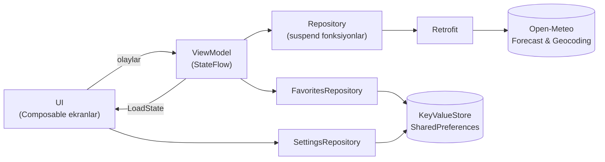
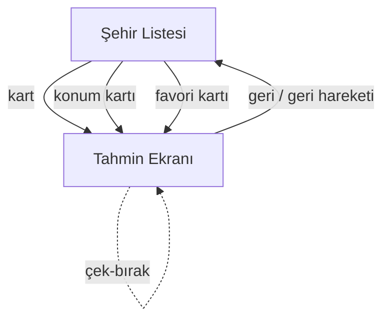

<div align="center">

# Kampplus Hava

**Türkiye'nin 81 ili için anlık, saatlik ve 7 günlük hava durumu — Jetpack Compose ile, Miuix (HyperOS) tasarım diliyle.**


</div>

> Bu proje, Bilişim Kampı Android eğitiminin referans çözümü olan
> [**tc-yusufburakdemir/weather-app**](https://github.com/tc-yusufburakdemir/weather-app)
> reposu temel alınarak geliştirilmiştir. Referans çözümün temel akışı (şehir ara → anlık / saatlik / 7 günlük tahmin,
> dört durumlu ekran yönetimi, 3 katmanlı mimari) korunmuş; üzerine kullanıcı deneyimini ve kod kalitesini artıran
> özellikler eklenmiştir. Neyin referanstan geldiği, neyin eklendiği aşağıda [Referans repodan farklar](#referans-repodan-farklar)
> bölümünde açıkça ayrılmıştır.

## Ekran görüntüleri

| Şehir listesi | Tahmin ekranı | Karanlık tema |
|:--:|:--:|:--:|
|  |  |  |

---

## İçindekiler

- [Ekran görüntüleri](#ekran-görüntüleri)
- [Özellikler](#özellikler)
- [Referans repodan farklar](#referans-repodan-farklar)
- [Teknoloji yığını](#teknoloji-yığını)
- [Mimari](#mimari)
- [Proje yapısı](#proje-yapısı)
- [Ekran akışı ve durum yönetimi](#ekran-akışı-ve-durum-yönetimi)
- [Veri kaynağı: Open-Meteo](#veri-kaynağı-open-meteo)
- [Konum özelliği](#konum-özelliği)
- [Kurulum ve çalıştırma](#kurulum-ve-çalıştırma)
- [Testler](#testler)
- [Erişilebilirlik ve tasarım kararları](#erişilebilirlik-ve-tasarım-kararları)
- [Bilinen sınırlar](#bilinen-sınırlar)
- [Kaynaklar ve lisanslar](#kaynaklar-ve-lisanslar)

---

## Özellikler

### Temel
| Özellik | Açıklama |
|---|---|
| **Şehir arama** | 81 il içinde, Türkçe karakter duyarsız arama: `muğla`, `mugla`, `MUĞLA` aynı sonucu verir. Sonuçlar yazılana göre (önce başlayanlar, sonra içerenler) ve Türkçe alfabeye göre sıralanır. |
| **Anlık hava durumu** | Sıcaklık, hissedilen sıcaklık, durum açıklaması ve animasyonlu simge. |
| **Saatlik tahmin** | Şu anki saatten başlayan 24 saatlik kaydırılabilir liste ("Şimdi" vurgulu). |
| **7 günlük tahmin** | "Bugün", "Yarın", ardından gün adı ve kısa tarih (`Cuma · 28 Şub`), en yüksek / en düşük sıcaklık. |
| **Dört durumlu ekranlar** | Yükleniyor (shimmer), veri, boş sonuç ve hata (+ "Tekrar Dene") ayrı ayrı tasarlandı. |

### Eklenenler
| Özellik | Açıklama |
|---|---|
| **Favori şehirler** | Kartlardaki ve tahmin ekranındaki yıldızla favori ekle / çıkar. Favoriler cihazda saklanır, arama boşken listenin başında görünür. |
| **Gerçek konum önerisi** | Konum izniyle cihaza en yakın il önerilir. İzin yok / konum alınamadı / Türkiye dışı durumları ayrı kartlarla anlatılır. |
| **Çek-bırak yenileme** | Tahmin ekranında aşağı çekerek yenile; hata olursa eski veri ekranda kalır. |
| **Dinamik arka plan** | Hava durumuna ve gündüz / geceye göre değişen, temaya yumuşakça karışan gradyan. |
| **Sıcaklık trendi grafiği** | Canvas ile çizilen, soldan sağa açılan, kaydırılabilir saatlik çizgi grafik (ek kütüphane yok). |
| **Ayrıntı kartları** | Rüzgar, nem, yağış, **UV indeksi** (seviye etiketli), **basınç**, **görüş mesafesi**, **gün doğumu / batımı**. |
| **°C / °F** | Üst çubuktaki düğmeyle birim değişimi; tercih hatırlanır. |
| **Paylaşılan geçiş** | Şehir kartı, tahmin ekranına "kapsayıcı dönüşümü" ile genişler. |
| **Öngörülü geri hareketi** | Android predictive back desteği etkin. |
| **Ana ekran widget'ı** | Glance ile yazılmış widget + WorkManager ile 3 saatlik periyodik senkron iskeleti (bkz. [Bilinen sınırlar](#bilinen-sınırlar)). |
| **Açık / koyu tema** | Sistem temasını izler; hava simgelerinin gece varyantları da vardır. |
| **Tamamen Türkçe** | Tüm metinler `strings.xml` içinde; kodda sabit metin yok. |

---

## Referans repodan farklar

| Alan | Referans çözüm ([weather-app](https://github.com/tc-yusufburakdemir/weather-app)) | Bu proje |
|---|---|---|
| Çekirdek akış | Şehir ara → anlık / saatlik / 7 günlük | Korundu |
| Ekran durumları | Loading / Data / Empty / Error, shimmer, "Tekrar dene" | Korundu |
| Mimari | UI → ViewModel (StateFlow) → Repository → Retrofit → Open-Meteo | Korundu |
| Paket düzeni | `model/`, `data/`, `ui/{city,forecast,component,theme}` | Korundu (+ `widget/`) |
| API anahtarı | Gerekmez | Gerekmez |
| Arayüz kiti | Material 3 | **Miuix (HyperOS)** bileşenleri |
| Favoriler | — | Kalıcı favori şehirler |
| Konum | — | Yaklaşık konuma göre il önerisi |
| Tahmin ayrıntıları | Sıcaklık, rüzgar, nem, yağış | + UV, basınç, görüş, gün doğumu / batımı |
| Birim | °C | °C / °F anahtarı |
| Görselleştirme | Liste | Canvas sıcaklık grafiği, dinamik arka plan |
| Etkileşim | — | Çek-bırak yenileme, paylaşılan geçiş, öngörülü geri |
| Veri düzeni | Ham tarih / saat | "Bugün / Yarın / Cuma", "Şimdi" ile başlayan saatlik liste |
| Hata mesajları | Sistem mesajı | Bağlantı hatasında yerelleştirilmiş, anlaşılır metin |
| Widget | — | Glance widget iskeleti |

---

## Teknoloji yığını

| Katman | Kullanılanlar |
|---|---|
| Dil | Kotlin 2.2.10 |
| Arayüz | Jetpack Compose (BOM `2026.02.01`), [Miuix](https://github.com/compose-miuix-ui/miuix) `0.8.8`, Material ikonları (extended) |
| Gezinme | Navigation Compose `2.8.7` — `SharedTransitionLayout` ile paylaşılan geçişler |
| Durum | `ViewModel` + `StateFlow`, `collectAsStateWithLifecycle` |
| Eşzamanlılık | Kotlin Coroutines |
| Ağ | Retrofit `2.11.0` + Gson `2.11.0` |
| Arka plan | WorkManager `2.9.0` |
| Widget | Jetpack Glance `1.1.0` |
| Konum | Platform `LocationManager` (Google Play Hizmetleri gerekmez) |
| Saklama | `SharedPreferences` üzerinde küçük `KeyValueStore` soyutlaması + Gson |
| Test | JUnit 4, `kotlinx-coroutines-test` |
| Derleme | Android Gradle Plugin `9.4.1`, `compileSdk` / `targetSdk` 37, `minSdk` 24, release için R8 |

---

## Mimari

Referans çözümdeki gibi **üç katmanlı** bir yapı kullanılır; bağımlılıklar tek yönlüdür ve ViewModel'ler Android `Context`'ine bağlı değildir.



**Önemli tasarım kararları**

- **`LoadState<T>`** — `Loading`, `Success`, `Empty`, `Error` olarak kapalı (sealed) bir arayüz. Her ekran dört durumu da açıkça ele alır. `Error` ayrıca `isNetwork` bilgisi taşır; arayüz bağlantı hatasında teknik istisna mesajı yerine Türkçe, anlaşılır bir metin gösterir.
- **Test edilebilirlik** — `FavoritesRepository` ve `SettingsRepository`, `Context` yerine `KeyValueStore` arayüzüne bağlıdır. Testlerde bellek içi sürüm kullanılır.
- **Tek örnek paylaşımı** — Şehir listesi ViewModel'i ile tahmin ekranı aynı favori akışını paylaşmalıdır; bu yüzden repository'ler `ServiceLocator` ile süreç genelinde tek örnek olarak üretilir (ek DI kütüphanesi yok).
- **Yerelleştirilmiş durum metni** — `WeatherCondition` hem ikonu hem de `@StringRes` açıklamayı taşır; metinler `strings.xml`'den gelir.
- **Mapper** — API'nin "paralel sütun" biçimindeki yanıtı (`time[]`, `temperature_2m[]` …) `toForecast()` ile satır tabanlı modellere çevrilir; saatlik liste yerel saatle "şu anki saat"ten başlatılır.

---

## Proje yapısı

```text
KampplusHava/
├── app/
│   └── src/
│       ├── main/
│       │   ├── java/com/kampplus/hava/
│       │   │   ├── MainActivity.kt
│       │   │   ├── model/
│       │   │   │   ├── City.kt               # 81 il, plaka kodları, en yakın il hesabı
│       │   │   │   ├── Forecast.kt           # CurrentWeather / HourlyForecast / DailyForecast
│       │   │   │   ├── WeatherCondition.kt   # WMO kodu → ikon + Türkçe açıklama
│       │   │   │   └── TemperatureUnit.kt    # °C / °F dönüşümü
│       │   │   ├── data/
│       │   │   │   ├── ApiClient.kt          # Retrofit örnekleri
│       │   │   │   ├── ForecastApi.kt        # /v1/forecast
│       │   │   │   ├── CityApi.kt            # Geocoding araması
│       │   │   │   ├── ForecastResponse.kt   # DTO + toForecast() mapper
│       │   │   │   ├── WeatherRepository.kt
│       │   │   │   ├── CityRepository.kt     # Türkçe duyarsız arama + çevrimdışı yedek
│       │   │   │   ├── FavoritesRepository.kt
│       │   │   │   ├── SettingsRepository.kt
│       │   │   │   ├── KeyValueStore.kt
│       │   │   │   ├── LocationProvider.kt   # LocationManager ile yaklaşık konum
│       │   │   │   └── ServiceLocator.kt
│       │   │   ├── ui/
│       │   │   │   ├── HavaNavHost.kt        # Gezinme + paylaşılan geçişler + konum izni
│       │   │   │   ├── LoadState.kt
│       │   │   │   ├── SharedTransitions.kt
│       │   │   │   ├── city/                 # CityScreen, CityCard, CityViewModel
│       │   │   │   ├── forecast/             # ForecastScreen, ViewModel, grafik, biçimlendirme
│       │   │   │   ├── component/            # ShimmerList, ErrorView, EmptyView, WeatherBackground …
│       │   │   │   └── theme/                # Miuix teması, Spacing, Type
│       │   │   └── widget/                   # Glance widget + WorkManager
│       │   └── res/                          # strings.xml (tr), hava simgeleri (gündüz / gece)
│       └── test/                             # Birim testleri
├── METEOCONS_LICENSE.md
└── README.md
```

---

## Ekran akışı ve durum yönetimi



| Ekran | Durumlar |
|---|---|
| **Şehir listesi** | Yükleniyor → shimmer · Veri → favoriler + tüm iller · Boş → "il bulunamadı" · Hata → mesaj + *Tekrar Dene* |
| **Tahmin** | Yükleniyor → gösterge · Veri → başlık, ayrıntılar, saatlik, grafik, 7 gün · Boş · Hata + *Tekrar Dene* |
| **Konum kartı** | İzin yok · Türkiye dışı · Konum alınamadı · Öneri bulundu |

Arama 300 ms **debounce** edilir; her yeni harfte önceki arama iptal edilir.

---

## Veri kaynağı: Open-Meteo

[Open-Meteo](https://open-meteo.com/) **API anahtarı gerektirmez**. Ücretsiz kullanım ticari olmayan projeler içindir (günde yaklaşık 10.000 istek).

| Amaç | Uç nokta |
|---|---|
| Tahmin | `GET https://api.open-meteo.com/v1/forecast` |
| Şehir arama | `GET https://geocoding-api.open-meteo.com/v1/search` |

Tahmin isteği şu alanları ister (`timezone=auto`, `forecast_days=7`):

| Grup | Alanlar |
|---|---|
| `current` | `temperature_2m`, `relative_humidity_2m`, `apparent_temperature`, `is_day`, `precipitation`, `weather_code`, `wind_speed_10m`, `surface_pressure`, `visibility`, `uv_index` |
| `hourly` | `temperature_2m`, `weather_code` |
| `daily` | `weather_code`, `temperature_2m_max`, `temperature_2m_min`, `sunrise`, `sunset` |

> **Not:** API her zaman °C ve km/s döner; °F dönüşümü uygulama tarafında yapılır. Görüş mesafesi metreden km'ye çevrilir.

**Arama stratejisi.** Geocoding API 3 harften kısa aramalarda yalnızca tam eşleşme döndürür ve bazı illeri il adıyla bulamaz (ör. *Kocaeli → İzmit*). Bu yüzden API sonuçları `featureCode == "PPLA"` (il merkezi) ile süzülür, eksik kalan iller **yerel 81 il listesinden** tamamlanır. İnternet yoksa arama doğrudan yerel listeden yapılır.

---

## Konum özelliği

- Yalnızca **yaklaşık konum** (`ACCESS_COARSE_LOCATION`) istenir; il düzeyi öneri için yeterlidir.
- Konum yalnızca cihazda işlenir ve hiçbir yere gönderilmez; en yakın il, 81 il merkezine **haversine** mesafesiyle bulunur.
- En yakın il merkezi **250 km**'den uzaksa konum Türkiye dışı sayılır ve öneri yapılmaz (aksi halde yurt dışındaki bir konuma en yakın sınır ili önerilirdi).
- Önce son bilinen konum kullanılır; yoksa (Android 11+) 8 sn zaman aşımıyla tek seferlik yeni konum istenir.
- İzin verilmezse uygulama sorunsuz çalışmaya devam eder.

> **Emülatörde test:** *Extended controls → Location* bölümünden Türkiye'de bir nokta seçin. Varsayılan emülatör konumu Kaliforniya'dır ve "Türkiye dışında" kartını gösterir.

---

## Kurulum ve çalıştırma

**Gereksinimler:** Android Studio (AGP 9.4.1 destekli sürüm), JDK 17+ (Android Studio ile gelen JDK yeterlidir), Android SDK 37.

```bash
# Depoyu klonlayın
git clone <bu-reponun-adresi>
cd KampplusHava
```

Android Studio ile açıp **Run** düğmesine basabilir ya da komut satırını kullanabilirsiniz:

```bash
# Debug APK üret
./gradlew assembleDebug            # Windows: gradlew.bat assembleDebug

# Birim testlerini çalıştır
./gradlew testDebugUnitTest

# Release (R8 etkin) APK
./gradlew assembleRelease
```

APK çıktısı: `app/build/outputs/apk/debug/app-debug.apk`

> API anahtarı veya ek yapılandırma gerekmez; yalnızca internet bağlantısı yeterlidir.

---

## Testler

Birim testleri `app/src/test` altındadır ve ağ / Android çalışma zamanı gerektirmez.

| Test | Neyi doğrular |
|---|---|
| `WeatherConditionTest` | WMO hava kodlarının ikon ve açıklamaya eşlenmesi, bilinmeyen kod |
| `ForecastApiTest` | Paralel sütunlu yanıtın satır tabanlı modellere dönüşümü |
| `ForecastFormatTest` | Gün adı / kısa tarih (TR, EN, hatalı girdi), UV seviyeleri, °C ↔ °F, saatlik listenin güncel saatten başlaması, yeni alanların eşlenmesi |
| `CityApiTest`, `CityRepositoryTest` | Geocoding eşlemesi, Türkçe duyarsız arama ve sıralama |
| `CityViewModelTest`, `ForecastViewModelTest` | `Loading / Success / Empty / Error` durumları |
| `FavoritesRepositoryTest` | Favori ekle / çıkar, kalıcılık ve sıra, bozuk veri dayanıklılığı, birim tercihi |
| `NearestProvinceTest` | Koordinattan il bulma ve Türkiye dışı konumların elenmesi |

---

## Erişilebilirlik ve tasarım kararları

- Tüm dokunma hedefleri en az **48 dp** (`Spacing.MinTouchTarget`).
- İkonlar ve grafik için `contentDescription` verilmiştir; grafik, aralığı sesli özetler.
- Sıcaklıklarda **sabit genişlikli rakamlar** (`tabularNumerals`) kullanılır; değerler değişirken yerleşim kaymaz.
- Metin renkleri Miuix token'larından seçilmiştir; ikincil metinler WCAG AA kontrastını koruyacak şekilde belirlenmiştir.
- Arka plan tonu yüzeye şeffaflıkla karıştığı için metin kontrastı temaya yakın kalır.
- Tek vurgu rengi (`primary`) yalnızca ana değerlerde kullanılır; geri kalan arayüz nötrdür.
- Boşluklar serbest `dp` yerine `Spacing` ölçeğinden gelir.

---

## Bilinen sınırlar

- **Widget şu an örnek veri gösterir** (Ankara · 18°C). `WeatherSyncWorker` ağ çağrısını yapar ve widget'ı günceller, ancak dönen veri henüz widget içeriğine bağlanmamıştır.
- **Çevrimdışı önbellek yoktur.** İnternet yokken şehir araması yerel listeden çalışır; ancak hava durumu verisi yüklenemez ve hata ekranı gösterilir.
- Konum önerisi **il düzeyindedir**; ilçe bazlı tahmin sunulmaz.
- Uygulama yalnızca **Türkçe** arayüze sahiptir.
- Veri sağlayıcı ücretsiz katmanı **ticari olmayan** kullanım içindir.

---

## Kaynaklar ve lisanslar

- **Referans proje:** [tc-yusufburakdemir/weather-app](https://github.com/tc-yusufburakdemir/weather-app) — Bilişim Kampı Android eğitimi referans çözümü.
- **Veri:** [Open-Meteo](https://open-meteo.com/) — hava durumu ve geocoding verisi (lisans / atıf koşulları için sitesine bakın).
- **Arayüz kiti:** [Miuix](https://github.com/compose-miuix-ui/miuix) — HyperOS tarzı Compose bileşenleri.
- **Hava simgeleri:** Meteocons — lisans metni için [`METEOCONS_LICENSE.md`](METEOCONS_LICENSE.md) dosyasına bakın.

<div align="center">

Kampplus Hava · Jetpack Compose ile geliştirilmiştir.
</div>
